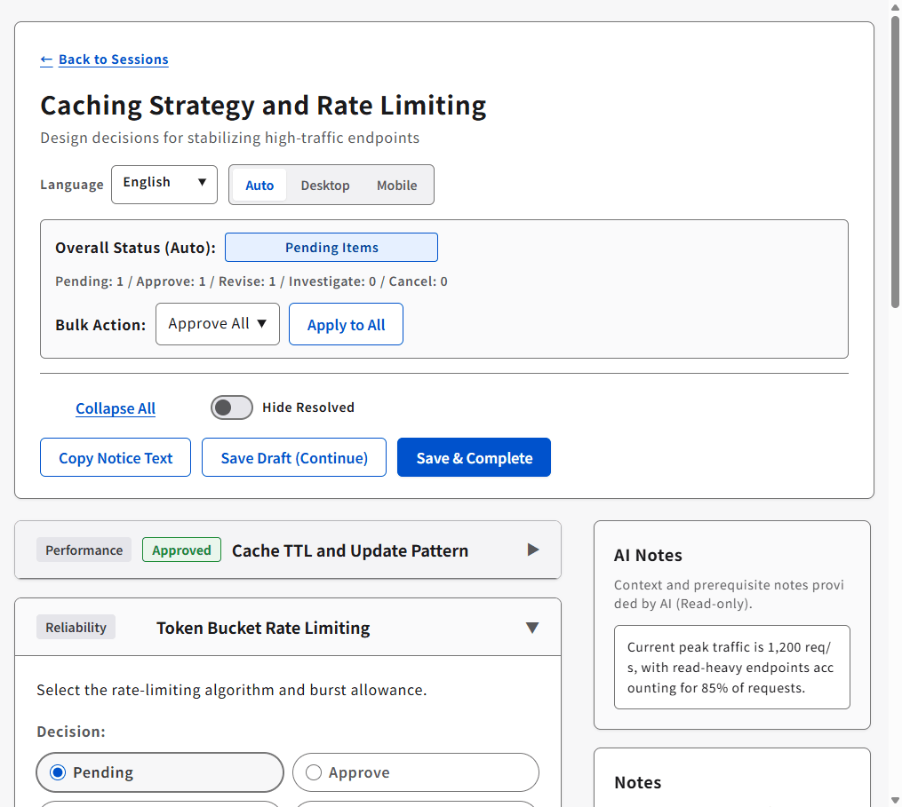
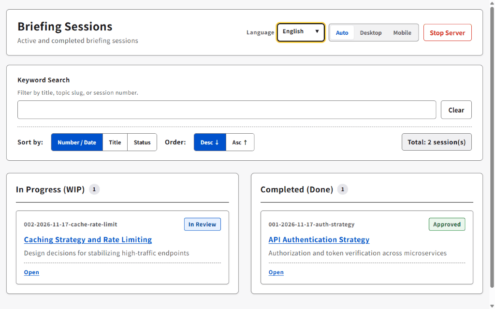

# briefing-board


[](./LICENSE.MIT)

[日本語](./README.md) | [English](./README.en.md)

An agent skill that organizes AI-prepared discussion topics, options, and comparison details onto a local web dashboard before implementation, letting you review and record decisions in a browser.

Suited for design discussions where threads get buried in long chats or when you want to hold off AI code changes and issue creation until every item is agreed on (for quick questions or small edits, regular chat is simpler).

<p align="center">
  
</p>

## Contents

- [Getting Started](#getting-started)
  - [Requirements and Installation](#requirements-and-installation)
  - [Triggering](#triggering)
- [Workflow](#workflow)
- [Key Features](#key-features)
  - [Decision-Focused Board UI](#decision-focused-board-ui)
  - [Pre-Approval Guard and Kanban Portal](#pre-approval-guard-and-kanban-portal)
  - [Local-First Operational Design](#local-first-operational-design)
- [Constraints and Design Trade-offs](#constraints-and-design-trade-offs)
- [Internal Architecture and References](#internal-architecture-and-references)
- [LICENSE](#license)

## Getting Started

### Requirements and Installation

Requires Python 3.11 or higher (uses standard library modules such as `tomllib`, so no external Python packages are needed).

**With Agent Skills Compatible Tools**

```bash
npx skills add DovahkiinYuzuko/briefing-board
```

**As an Antigravity Plugin**

```bash
agy plugin install https://github.com/DovahkiinYuzuko/briefing-board
```

### Triggering

This repository is distributed as an Agent Skill (`skills/briefing-board/SKILL.md`). Start a session in a compatible agent chat by invoking the skill (e.g., `/briefing-board` depending on your environment) or using a natural-language prompt requesting a pre-implementation briefing:

- `/briefing-board`
- Phrases such as "let's do a briefing", "open the briefing board", or "help me decide the approach"

---

## Workflow

1. **Organize topics and open the board**: When triggered, the AI structures discussion topics, options, and context into a TOML agenda, starts the local HTTP server, and shares the URL (`http://localhost:<PORT>/wip/<session-folder>/`).
2. **Compare, decide, and save in the browser**: Pick a status per topic from five choices (`Pending`, `Approve`, `Revise`, `Investigate`, or `Cancel`), select options, add comments or new topic proposals if needed, and save.
3. **Hold off implementation until open items are resolved**: While saved as a draft or while any topic remains `Pending`, `Revise`, or `Investigate`, the AI holds off on code implementation and issue creation, updating the board with your feedback.
4. **Archive and wrap up after full agreement**: Once every topic is `Approve` or `Cancel`, the AI confirms whether to create tasks or issues, moves the session to `done/`, rebuilds the portal, and shuts down the server.

---

## Key Features

### Decision-Focused Board UI

- **Five-status decisions and bulk controls**: Set each topic to `Pending`, `Approve`, `Revise`, `Investigate`, or `Cancel`, apply statuses in bulk, and filter the view with the "Hide Resolved" toggle or "Collapse All".
- **Code, math, and notes side by side**: Display code snippets (syntax-highlighted), formulas (LaTeX), and AI notes per topic, while recording global user notes and proposing new topics on the same page.

### Pre-Approval Guard and Kanban Portal

- **Two-column WIP / Done portal**: The project root URL (`http://localhost:<PORT>/`) presents a Kanban view of in-progress (`wip/`) and archived (`done/`) sessions with live search, sorting, and a server shutdown button.
- **Structured output and handoff**: Saving in the browser writes `decision.toml` and generates `summary.md` in the active UI language. A header button copies a ready-to-paste notice telling the AI that your review is complete.

<p align="center">
  
</p>

### Local-First Operational Design

- **Automatic `.gitignore` generation**: On the first session run, creates `.gitignore` (`*` and `!.gitignore`) inside the output directory so session files stay out of Git history.
- **Per-project ports and LAN access**: Derives a dedicated port (`8899..8998`) from the CRC32 hash of the output directory and binds to `0.0.0.0`, allowing access from phones or tablets on the same LAN.
- **Multilingual UI and scoped settings**: Switch between `日本語` and `English` and adjust view modes (`Auto`, `Desktop`, `Mobile`) from the header. UI language and view mode persist globally on the skill side, while portal sort order and search filters persist per project.

---

## Constraints and Design Trade-offs

- **Math and code rendering offline**: Math (KaTeX `0.16.8`), syntax highlighting (PrismJS `1.29.0`), and fonts (Google Fonts: `Noto Sans JP` / `Noto Sans Mono`) load from CDNs. This avoids external package managers and frontend build steps so the tool runs on the Python standard library alone; offline, those elements fall back to plain text while option selection and saving continue to work.
- **Saving when opened via `file://`**: Opening the generated HTML files directly without a running server still supports viewing sessions and downloading `decision.toml`. Auto-saving to disk (`POST /api/save`), `summary.md` generation, and settings persistence (`/api/settings`) require accessing the board over the HTTP URL served by `server.py`.
- **Static portal updates**: The Kanban portal (`briefing-board/index.html`) is rebuilt statically when sessions are created, updated, or archived. Normal usage keeps it up to date automatically; if you move session folders manually on disk, run `new_briefing.py --rebuild-portal` to refresh the list.

---

## Internal Architecture and References

<details>
<summary>Component responsibilities, implementation details, and specification links</summary>

### Component Responsibilities

| Path | Responsibility |
| :--- | :--- |
| `plugin.json` | Manifest definition for Antigravity plugin installation. |
| `skills/briefing-board/SKILL.md` | Agent execution protocol (5-step workflow, decision tree, and pre-approval implementation guard). |
| `skills/briefing-board/scripts/new_briefing.py` | Schema validation for input TOML/JSON, session creation and in-place updates (`--update-session`), validated archiving (`--archive <session-folder>`, server shutdown is separate), portal rebuilding (`--rebuild-portal`), and server startup orchestration. |
| `skills/briefing-board/scripts/server.py` | Local HTTP server (`GET /api/decision`, `POST /api/save`, `GET/POST /api/settings`, `POST /api/shutdown`) and `summary.md` generation. |
| `skills/briefing-board/scripts/briefing_common.py` | Shared utilities for TOML/JSON loading, deterministic port calculation, and reading/writing `user_settings.json` and `portal_settings.json`. |
| `skills/briefing-board/resources/` | Frontend assets aligned with DADS (Digital Agency Design System) tokens (`index.html`, `portal.html`, `app.js`, `style.css`). |
| `skills/briefing-board/locales/` | Localization bundles (`en.json`, `ja.json`). |
| `skills/briefing-board/references/` | Schema specification, CLI reference, and agenda input template. |

### Runtime Behavior and Settings

- **Port allocation and probing**: Computes an initial port in `8899..8998` from the CRC32 hash of the output directory path and probes up to `+20` if the port is already in use.
- **Settings storage**: UI language and view mode are stored in `skills/briefing-board/user_settings.json`, while per-project portal sort and search state are stored in `portal_settings.json` under the output directory.
- **Adding languages**: Place additional JSON locale files named by language code under `skills/briefing-board/locales/` to extend UI language support.

### Reference Documents

- Skill definition: [SKILL.md](./skills/briefing-board/SKILL.md)
- CLI arguments and HTTP API endpoints (for development and verification): [cli_reference.md](./skills/briefing-board/references/cli_reference.md)
- Input/output TOML schema (`briefing.toml` / `decision.toml`): [schema_specification.md](./skills/briefing-board/references/schema_specification.md)
- Input template: [agenda_template.toml](./skills/briefing-board/references/agenda_template.toml)

</details>

---

## LICENSE

[MIT](./LICENSE.MIT)

Third-Party → [NOTICE.md](./NOTICE.md)

This skill's UI is an independent implementation referencing the [Digital Agency Design System (DADS)](https://design.digital.go.jp/dads/) specifications and is not created or provided directly by the Digital Agency of Japan.
