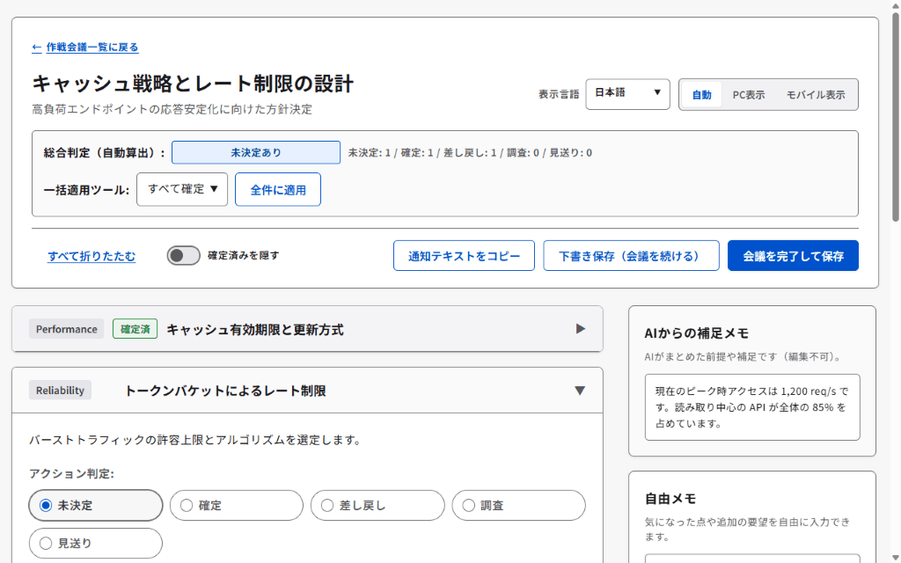
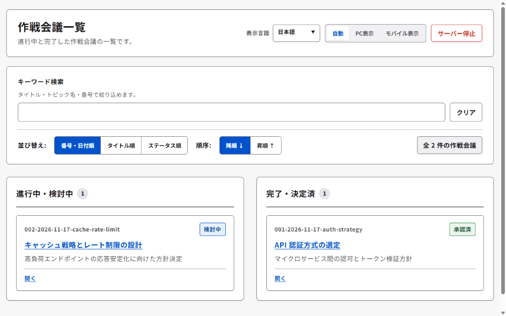

# briefing-board


[](./LICENSE.MIT)

[日本語](./README.md) | [English](./README.en.md)

実装前の設計相談や方針決めで、AI が整理した論点・選択肢・比較情報をローカルの Web 画面にまとめ、ブラウザ上で確認・意思決定できるエージェントスキルです。

チャットのやり取りだけでは論点が流れてしまいやすい場面や、すべての項目で合意が取れるまで AI の実装着手やタスク起票を止めておきたい場面に向いています（単発の質問や小さな修正は、通常のチャット応答のほうが手軽です）。

<p align="center">
  
</p>

## 目次

- [briefing-board](#briefing-board)
  - [目次](#目次)
  - [導入と起動](#導入と起動)
    - [動作要件とインストール](#動作要件とインストール)
    - [起動方法](#起動方法)
  - [使い方](#使い方)
  - [主な機能](#主な機能)
    - [意思決定を助けるボード UI](#意思決定を助けるボード-ui)
    - [合意前の実装を防ぐガードとカンバン管理](#合意前の実装を防ぐガードとカンバン管理)
    - [ローカル完結の運用設計](#ローカル完結の運用設計)
  - [制約と設計上のトレードオフ](#制約と設計上のトレードオフ)
  - [内部構成とリファレンス](#内部構成とリファレンス)
    - [コンポーネントの役割](#コンポーネントの役割)
    - [動作仕様と設定](#動作仕様と設定)
    - [詳細仕様ドキュメント](#詳細仕様ドキュメント)
  - [LICENSE](#license)

## 導入と起動

### 動作要件とインストール

Python 3.11 以上が必要です（標準ライブラリの `tomllib` 等を使用するため、外部 Python パッケージの追加インストールは不要です）。

**Agent Skills 対応環境へ導入する場合**

```bash
npx skills add DovahkiinYuzuko/briefing-board
```

**Antigravity プラグインとして導入する場合**

```bash
agy plugin install https://github.com/DovahkiinYuzuko/briefing-board
```

### 起動方法

このリポジトリは Agent Skill（`skills/briefing-board/SKILL.md`）として提供されています。対応するエージェントとの会話で、スキル呼び出し（環境によっては `/briefing-board`）または設計相談を求めるフレーズを入力すると起動します。

- `/briefing-board`
- 「作戦会議したい」「ブリーフィングボードを開いて」「方針決めをしたい」

---

## 使い方

1. **論点を整理してボードを開く**: スキルが起動すると、AI が論点・選択肢・背景を TOML 形式のアジェンダにまとめてローカル HTTP サーバーを起動し、URL（`http://localhost:<PORT>/wip/<session-folder>/`）を案内します。
2. **ブラウザ上で比較・判定して保存する**: 各論点について 5 つの判定（`未決定` / `確定` / `差し戻し` / `調査` / `見送り`）からステータスを選び、選択肢の決定やコメント・新規論点の追加を行って保存します。
3. **未決・差し戻しが残る間は AI が待機して再整理する**: 下書き保存中、または `未決定`・`差し戻し`・`調査` の項目が 1 つでも残っている間は、AI はコード実装やタスク起票へ進まず、フィードバックを反映してボードを更新します。
4. **全項目の合意後にアーカイブして閉じる**: すべての論点が `確定` または `見送り` になると、タスク化の要否を確認したうえでセッションを `done/` へ移動し、ポータルを更新してサーバーを停止します。

---

## 主な機能

### 意思決定を助けるボード UI

- **5 択ステータスと一括操作**: 論点ごとに `未決定` / `確定` / `差し戻し` / `調査` / `見送り` を設定でき、全項目への一括適用や「確定済みを隠す」スイッチ・全カード折りたたみによる絞り込みに対応しています。
- **コード・数式・メモの併記**: 論点ごとにコードスニペット（構文ハイライト対応）や数式（LaTeX 記法対応）、AI 側の補足メモを表示でき、ユーザー側の全体メモや新しい論点の追加提案も同一画面から行えます。

### 合意前の実装を防ぐガードとカンバン管理

- **WIP / Done の 2 カラムポータル**: プロジェクトのルート画面（`http://localhost:<PORT>/`）では、進行中（`wip/`）と完了済み（`done/`）のセッションをカンバン形式で一覧でき、リアルタイム検索や並び替え、サーバー停止操作を行えます。
- **構造化された出力と引き継ぎ**: ブラウザで保存すると `decision.toml` と、選択中の表示言語に応じたまとめドキュメント `summary.md` が自動生成されます。ヘッダーのコピーボタンから、AI へ回答完了を伝える定型通知文も取得できます。

<p align="center">
  
</p>

### ローカル完結の運用設計

- **`.gitignore` の自動生成**: 初回セッション作成時に出力先ディレクトリへ `.gitignore`（`*` と `!.gitignore`）を自動生成するため、会議ログや一時ファイルが Git の作業ツリーを汚しません。
- **プロジェクト別ポートと LAN 共有**: サーバーは出力先パスの CRC32 ハッシュから専用ポート（`8899..8998`）を決定し、`0.0.0.0` で待ち受けるため、同じ LAN 内のスマートフォンやタブレットからもボードを閲覧・回答できます。
- **多言語 UI とスコープ別の設定保持**: ヘッダーから `日本語` / `English` の表示言語と表示モード（`自動` / `PC表示` / `モバイル表示`）を切り替えられます。UI 言語と表示モードはスキル側で全プロジェクト共通に保持し、ポータルの並び順・検索条件はプロジェクト単位で保存します。

---

## 制約と設計上のトレードオフ

- **オフライン環境での数式・コード表示**: 数式（KaTeX `0.16.8`）、構文ハイライト（PrismJS `1.29.0`）、フォント（Google Fonts: `Noto Sans JP` / `Noto Sans Mono`）は CDN から読み込みます。外部パッケージ管理やフロントエンドのビルド工程を省いて Python 標準ライブラリだけで完結させるための選択であり、オフライン環境では該当部分がプレーンテキスト表示へフォールバックします（選択肢の選択と保存機能はそのまま動作します）。
- **`file://` 直開き時の保存範囲**: サーバーを起動せずにローカルの HTML ファイルを直接開いた場合でも、ボードの閲覧と `decision.toml` のダウンロードまでは可能です。一方で、サーバー側への自動保存（`POST /api/save`）、`summary.md` の自動生成、設定の永続化（`/api/settings`）を利用する場合は、`server.py` が提供する HTTP URL 経由でアクセスする構成をとっています。
- **セッション一覧の静的生成**: カンバンポータル（`briefing-board/index.html`）は、セッションの作成・更新・アーカイブのタイミングで静的に再生成されます。通常操作では自動で最新の状態に保たれますが、OS 側でセッションフォルダを手動移動した場合に限り、`new_briefing.py --rebuild-portal` を実行して一覧を再構築できます。

---

## 内部構成とリファレンス

<details>
<summary>ディレクトリ・コンポーネントの役割、詳細仕様、ドキュメントリンクを開く</summary>

### コンポーネントの役割

| パス | 役割 |
| :--- | :--- |
| `plugin.json` | Antigravity プラグイン導入用のマニフェスト定義。 |
| `skills/briefing-board/SKILL.md` | エージェント向けの実行プロトコル（5 ステップ、決定木、合意前実装禁止ガード）の定義。 |
| `skills/briefing-board/scripts/new_briefing.py` | 入力 TOML/JSON のスキーマ検証、セッション作成・上書き更新（`--update-session`）、完了条件検証付きアーカイブ（`--archive <session-folder>`、サーバー停止は別処理）、ポータル再構築（`--rebuild-portal`）、サーバー起動の制御。 |
| `skills/briefing-board/scripts/server.py` | ローカル HTTP サーバー（`GET /api/decision`, `POST /api/save`, `GET/POST /api/settings`, `POST /api/shutdown`）および `summary.md` 自動生成の担当。 |
| `skills/briefing-board/scripts/briefing_common.py` | TOML/JSON 読み込み、プロジェクト別ポート番号の算出、`user_settings.json` / `portal_settings.json` の読み書きなどの共通処理。 |
| `skills/briefing-board/resources/` | DADS（デジタル庁デザインシステム）トークン準拠のフロントエンド実装（`index.html`, `portal.html`, `app.js`, `style.css`）。 |
| `skills/briefing-board/locales/` | 多言語定義ファイル（`en.json`, `ja.json`）。 |
| `skills/briefing-board/references/` | スキーマ仕様、CLI リファレンス、入力テンプレート。 |

### 動作仕様と設定

- **ポート番号の算出と探索**: 出力先ディレクトリのパスに対する CRC32 ハッシュから `8899..8998` の範囲で初期ポートを決定し、使用中の場合は `+20` まで空きポートを探索します。
- **設定ファイルの保存先**: UI 言語と表示モードはスキル側の `skills/briefing-board/user_settings.json`、ポータルの並び順・検索条件はプロジェクト出力先の `portal_settings.json` に分割保存されます。
- **対応言語の拡張**: `skills/briefing-board/locales/` 配下に言語コード名の JSON ファイルを追加すると、表示言語を増やせます。

### 詳細仕様ドキュメント

- スキル定義本体: [SKILL.md](./skills/briefing-board/SKILL.md)
- CLI 引数・HTTP API 仕様（開発・動作確認向け）: [cli_reference.md](./skills/briefing-board/references/cli_reference.md)
- 入出力 TOML（`briefing.toml` / `decision.toml`）スキーマ仕様: [schema_specification.md](./skills/briefing-board/references/schema_specification.md)
- 入力テンプレート: [agenda_template.toml](./skills/briefing-board/references/agenda_template.toml)

</details>

---

## LICENSE

[MIT](./LICENSE.MIT)

Third-Party → [NOTICE.md](./NOTICE.md)

本スキルの UI は[デジタル庁デザインシステム（DADS）](https://design.digital.go.jp/dads/)の仕様を参照して独自に実装したものであり、デジタル庁が直接作成または提供するものではありません。
